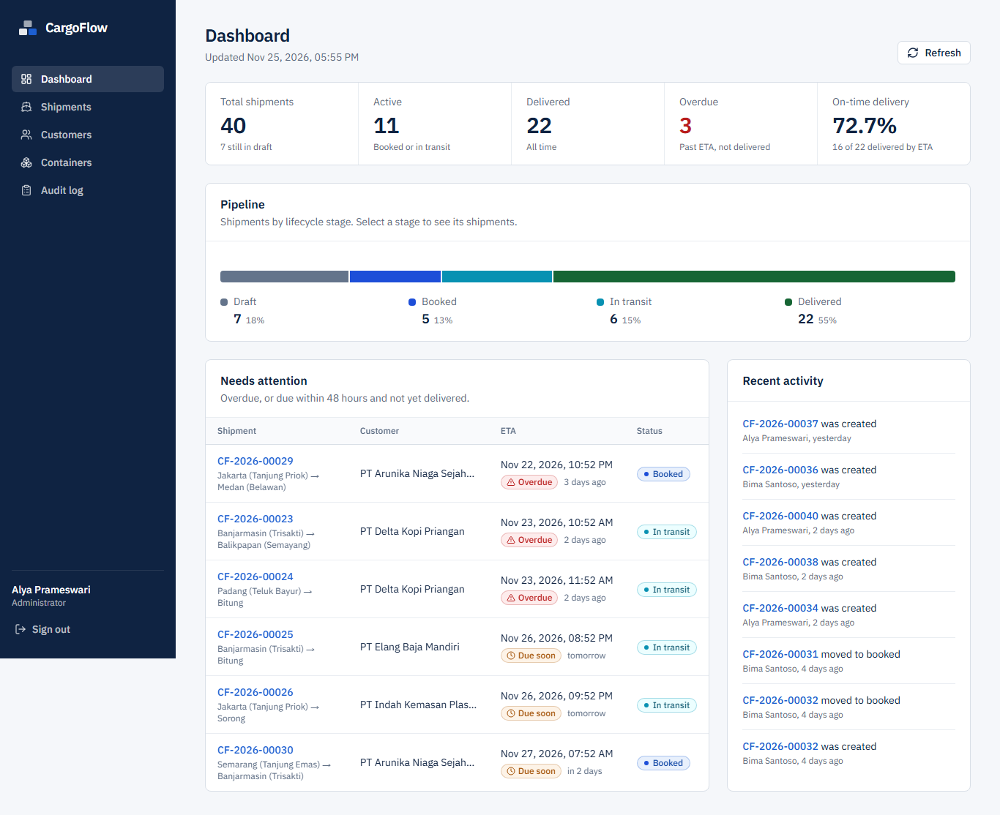
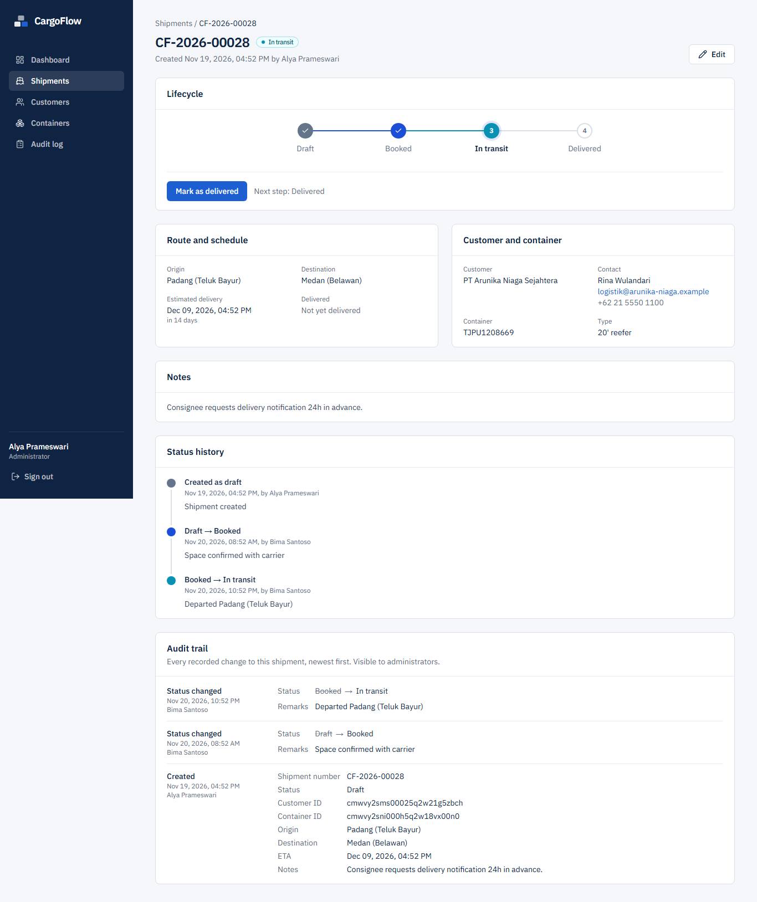
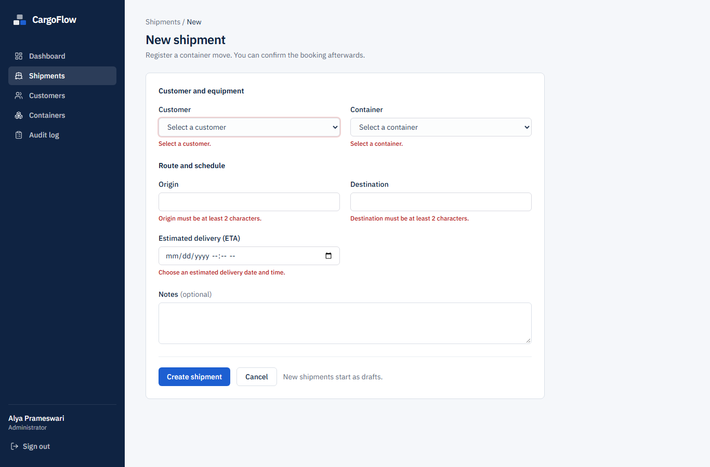
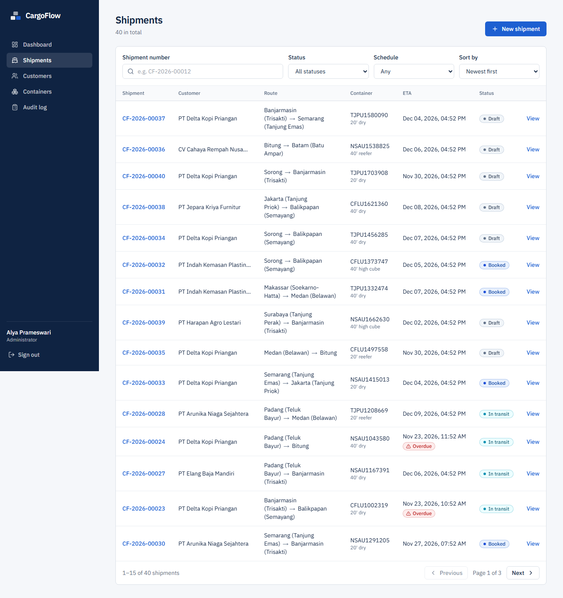
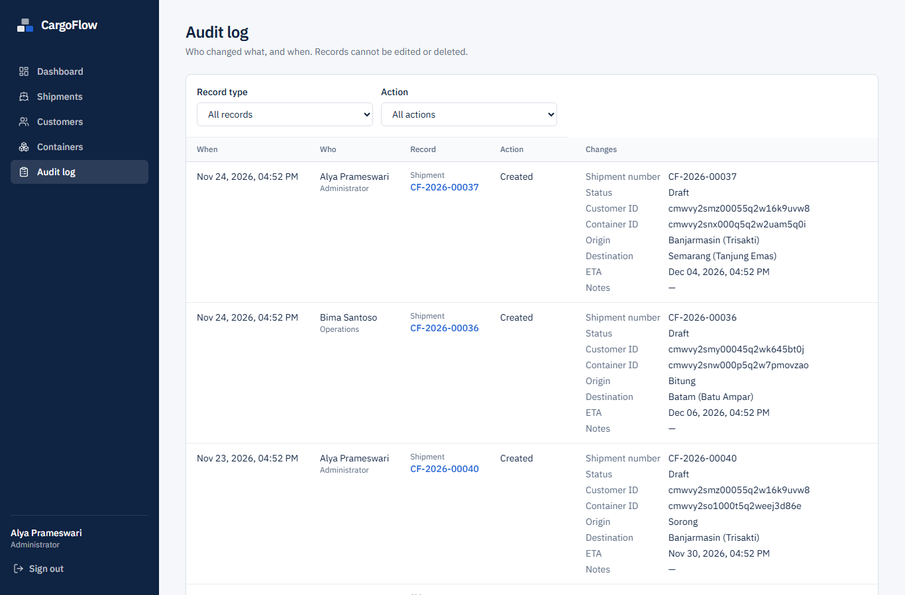
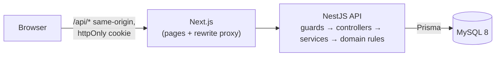

# CargoFlow

**Container shipment operations platform:** bookings, lifecycle milestones, ETA monitoring,
an operational dashboard and a full audit trail.

> Original demonstration project with **synthetic data**. Not affiliated with any real logistics
> company or system.



## The problem

A logistics team moving containers between Indonesian ports tracks bookings in spreadsheets and
chat. Nobody sees all shipments in one place, delays surface only when a customer complains,
changes can't be traced, and rules like "a container can't be on two active jobs" depend on
discipline. CargoFlow puts the lifecycle, the rules and the history in one system.
[Business requirements →](docs/BRD.md)

## Features

- **Shipment lifecycle** `DRAFT → BOOKED → IN_TRANSIT → DELIVERED`, enforced by the server, one
  step at a time, with confirmation, remarks and a timeline.
- **Editing rules by status and role:** drafts are fully editable (customer reassignment is
  admin-only); booked or in-transit shipments allow only ETA and notes; delivered ones are read-only.
- **Overdue detection** derived from ETA and status, never stored, flagged in lists, detail and dashboard.
- **Dashboard** computed by MySQL aggregation: total, active, delivered, overdue, on-time delivery
  rate, status pipeline, shipments needing attention (overdue or due within 48h), recent activity.
- **Shipment list** with number search, status, customer and overdue filters, ETA/created sorting,
  pagination, and filters kept in the URL.
- **Audit trail** of every create, edit and status change with before/after values, written in
  the same transaction as the change (admin-only view).
- **Customers** (admin-managed) and **containers** (ISO 6346 numbers with check-digit validation;
  one active shipment per container, safe under concurrent requests).
- **Role-based access** (ADMIN, OPERATIONS) enforced by the API; httpOnly session cookie; login rate limiting.
- Responsive UI with loading, empty, error and success states on every view.

| Shipment detail                                          | Create shipment (validation)                                        |
| -------------------------------------------------------- | ------------------------------------------------------------------- |
|  |  |
| **Shipments**                                            | **Audit log**                                                       |
|              |                         |

Mobile: [shipment detail at 390 px](docs/screenshots/mobile-shipment-detail.png). Screenshots were
captured from the running app with Playwright, using the seed data.

## Tech stack

| Layer    | Technology                                                                                                                                         |
| -------- | -------------------------------------------------------------------------------------------------------------------------------------------------- |
| Web      | Next.js 16 (App Router), React 19, TypeScript (strict), Tailwind CSS 4, shadcn-style components (Radix), TanStack Query 5, React Hook Form + Zod 4 |
| API      | NestJS 11, TypeScript (strict), Prisma 6, class-validator DTOs, JWT, Swagger/OpenAPI                                                               |
| Database | MySQL 8.4, Prisma migrations                                                                                                                       |
| Tests    | Jest + Supertest (API), Vitest + Testing Library (web), Playwright (E2E)                                                                           |
| Tooling  | pnpm workspaces, ESLint 9 (flat, type-aware), Prettier, GitHub Actions, Docker Compose (MySQL)                                                     |

## Architecture



A **modular monolith**: one API, one database, one transaction per business change. The status
change, its history event and its audit record commit together. Concurrent transitions are
resolved with compare-and-set updates, and container assignment with a row lock at READ
COMMITTED. Details: [ARCHITECTURE.md](docs/ARCHITECTURE.md) ·
[ERD](docs/ERD.md) · [ADRs](docs/ADR).

```
apps/api     NestJS API (src/<module>, prisma/schema.prisma, test/integration)
apps/web     Next.js app (src/app routes, src/components, src/lib/api)
docs/        BRD, PRD, architecture, ERD, API guide, test plan, ADRs, screenshots
infrastructure/mysql/init   creates the cargoflow_test database for local Docker MySQL
```

## Local setup

Prerequisites: **Node.js ≥ 20.11** (22 LTS recommended), **pnpm 9** (`corepack enable`), and
**MySQL 8** on `localhost:3307`. The included Docker Compose file provides it:

```bash
docker compose up -d mysql        # MySQL 8.4 on localhost:3307, creates cargoflow + cargoflow_test
```

Using your own MySQL instead? Create the `cargoflow` and `cargoflow_test` databases and a user, then
adjust the URLs in `apps/api/.env`.

```bash
pnpm install
cp apps/api/.env.example apps/api/.env      # then set JWT_SECRET (command in the file)
cp apps/web/.env.example apps/web/.env      # optional; defaults work locally

pnpm --filter @cargoflow/api db:deploy      # apply migrations
pnpm --filter @cargoflow/api db:seed        # synthetic demo data (repeatable; wipes CargoFlow tables)

pnpm dev                                    # API on :4000, web on :3000
```

Open **http://localhost:3000**. API docs (Swagger): **http://localhost:4000/api/docs**.

### Demo accounts (development only)

| Email                   | Role       |
| ----------------------- | ---------- |
| `admin@cargoflow.local` | ADMIN      |
| `ops@cargoflow.local`   | OPERATIONS |

Password: the `SEED_DEMO_PASSWORD` value in `apps/api/.env` (example: `CargoFlow!2026`). These
accounts exist only in seeded development databases.

### Environment variables

| File            | Variable                      | Purpose                                                                 |
| --------------- | ----------------------------- | ----------------------------------------------------------------------- |
| `apps/api/.env` | `DATABASE_URL`                | MySQL connection for the app                                            |
|                 | `TEST_DATABASE_URL`           | Integration tests; database name **must** end in `_test`                |
|                 | `JWT_SECRET`                  | ≥ 32 random characters; startup refuses the example value in production |
|                 | `JWT_EXPIRES_IN_SECONDS`      | Session length (default 28800 = 8h)                                     |
|                 | `WEB_ORIGIN`                  | CORS allow-list (comma-separated)                                       |
|                 | `COOKIE_SECURE`               | `true` when served over HTTPS                                           |
|                 | `LOGIN_RATE_LIMIT_PER_MINUTE` | Login attempts per IP per minute (default 10)                           |
|                 | `SEED_DEMO_PASSWORD`          | Password given to seeded demo users                                     |
| `apps/web/.env` | `API_ORIGIN`                  | Where Next.js proxies `/api/*` (default `http://localhost:4000`)        |
| `.env` (root)   | `MYSQL_*`                     | Optional Docker Compose overrides                                       |

## Running tests

```bash
pnpm test                    # unit: API (Jest, 98 tests) + web (Vitest, 54 tests)
pnpm test:integration        # API against MySQL cargoflow_test (67 tests)
pnpm --filter @cargoflow/web exec playwright install chromium   # once
pnpm test:e2e                # Playwright: login → create → book → depart → deliver → timeline
pnpm lint && pnpm typecheck && pnpm build
pnpm --filter @cargoflow/api db:explain    # EXPLAIN plans for dashboard and list queries
```

Strategy, scenarios and the latest verified results are in [TEST_PLAN.md](docs/TEST_PLAN.md).
CI (`.github/workflows/ci.yml`) runs format, lint, typecheck, unit tests and builds, then
integration tests and E2E against MySQL service containers.

## Example workflow

1. Sign in as `ops@cargoflow.local`. The dashboard shows what is overdue or due within 48 hours.
2. **Shipments → New shipment:** pick a customer and an available container, enter the route and
   ETA. The shipment is created as a draft with a number such as `CF-2026-00041`.
3. On the detail page, **Confirm booking → Mark as departed → Mark as delivered**, each with
   optional remarks. Delivery records the time and marks it on time or late.
4. The **Status history** shows every step. Sign in as `admin@cargoflow.local` to see the audit
   trail with before/after values, or the global **Audit log**.

The same flow with `curl` is in [API.md](docs/API.md#example-workflow-create--book--depart--deliver).

## Engineering decisions and challenges

- **A real race condition, found by a test.** Five concurrent creates for the same container all
  succeeded despite a `SELECT … FOR UPDATE`: under REPEATABLE READ, the availability check read a
  snapshot taken before the lock wait. A locking-read fix caused gap-lock deadlocks. The final fix
  runs container-assigning transactions at READ COMMITTED. [ADR 0003](docs/ADR/0003-transition-and-audit-consistency.md)
- **Compare-and-set transitions** (`UPDATE … WHERE status = <current>`): two simultaneous "mark
  as booked" requests produce exactly one change, one event and one audit record.
- **No business rules in the UI.** The API returns `allowedTransitions` and `editableFields` per
  user, and the web app renders only those controls.
- **Derived, not stored:** overdue, delivery performance and KPIs are computed, so they can't
  drift from the data. A `(status, estimatedDeliveryAt)` index lets MySQL answer every dashboard
  aggregate from the index alone (verified with `EXPLAIN`).
- **Token storage:** JWT in an httpOnly SameSite=Lax cookie, served first-party through the
  Next.js rewrite, so JavaScript never sees the token. Trade-offs are in
  [ARCHITECTURE.md](docs/ARCHITECTURE.md#authentication-and-authorization-flow).
- **Clean error contract:** one error body shape with stable codes. Body-parser failures that
  previously leaked parser text or returned 500 now map to 400/413/415.

## Limitations and future work

- Not production-hardened: no CSRF token (relies on SameSite=Lax), no token revocation or refresh,
  in-memory per-instance rate limiting, no Content-Security-Policy, no account lockout.
- No user-management UI; accounts are created by the seed script.
- Customer and container pickers load up to 100 entries; a larger dataset needs search-as-you-type.
- "Filter by status + newest first" still sorts in memory; a `(status, createdAt)` index would fix it at scale.
- The one-active-shipment-per-container rule is enforced by the application under a lock; a
  generated-column unique index could add a database-level guarantee.
- The optional Laravel quotation service was not built: PHP isn't available in the development
  environment, and the brief ranks it lowest priority.
- Possible next steps: notifications for overdue shipments, CSV export, carrier tracking
  integration, axe accessibility checks in CI.

## Documentation

[BRD](docs/BRD.md) · [PRD](docs/PRD.md) · [Architecture](docs/ARCHITECTURE.md) ·
[ERD](docs/ERD.md) · [API guide](docs/API.md) · [Test plan](docs/TEST_PLAN.md) ·
[ADR 0001](docs/ADR/0001-nestjs-modular-monolith.md) · [ADR 0002](docs/ADR/0002-mysql-and-prisma.md) ·
[ADR 0003](docs/ADR/0003-transition-and-audit-consistency.md)
