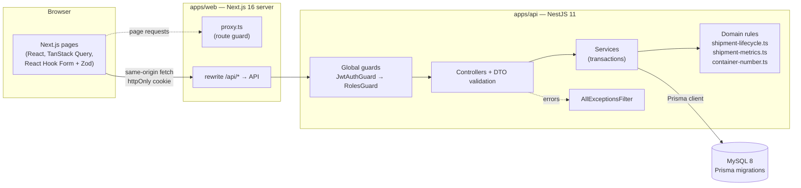

# CargoFlow — Architecture

CargoFlow is a **modular monolith**: one Next.js web app, one NestJS API, one MySQL database.
There are no queues, caches or extra services. The business rules all live in one process and one
database transaction, which keeps them easy to reason about.

## Components



| Part       | Responsibility                                                                                                                                                                              |
| ---------- | ------------------------------------------------------------------------------------------------------------------------------------------------------------------------------------------- |
| `apps/web` | UI only. Renders pages, validates forms for fast feedback, calls the API. It holds **no** business rules: which buttons appear comes from the API (`allowedTransitions`, `editableFields`). |
| `apps/api` | All business rules, authorization, persistence, audit. Swagger at `/api/docs`.                                                                                                              |
| MySQL      | Source of truth. Constraints (FKs, unique keys) back up the application rules.                                                                                                              |

### API modules (`apps/api/src`)

| Module                      | Contents                                                                                                                                                 |
| --------------------------- | -------------------------------------------------------------------------------------------------------------------------------------------------------- |
| `common/`                   | `CoreModule` (validated env, injectable `Clock`), validation pipe, pagination, error filter, request logger                                              |
| `prisma/`                   | `PrismaService` (one client per process)                                                                                                                 |
| `auth/`                     | login/logout/me, JWT signing, global `JwtAuthGuard` + `RolesGuard`, `@Public()` / `@Roles()` decorators                                                  |
| `customers/`, `containers/` | CRUD-style modules with audit records                                                                                                                    |
| `shipments/`                | `domain/` (pure functions: state machine, editing rules, route/ETA validation, overdue + KPI math), service (transactions), presenter (response shaping) |
| `dashboard/`                | KPIs computed with SQL aggregation                                                                                                                       |
| `audit/`                    | `AuditService.record(tx, …)` used inside other modules' transactions; ADMIN-only listing                                                                 |
| `health/`                   | `/api/health` with a database round-trip                                                                                                                 |

There is no separate `users` module. Users are provisioned by the seed script, and only `auth` reads them.

Each layer has one job. Controllers handle HTTP and DTOs. Services handle orchestration and
transactions. `domain/` holds rules as pure functions with no I/O, unit-tested in isolation.
Presenters shape responses.

## Frontend ↔ backend communication

- The browser only talks to the **Next.js origin**. `next.config.ts` rewrites `/api/*` to the
  API (`API_ORIGIN`, default `http://localhost:4000`). So the session cookie is first-party, the
  app needs no CORS, and the API URL is never exposed to client code.
- `src/lib/api/client.ts` is the single fetch wrapper. Every non-2xx response becomes an
  `ApiError { status, code, message, details }` built from the API's error body.
- TanStack Query caches server state. Mutations invalidate the affected lists, the dashboard and
  the audit queries. A transition conflict (409) triggers a refetch, so the screen shows the true
  current status.
- Forms (React Hook Form + Zod) mirror the API's DTO limits for instant feedback. The API stays
  authoritative: its field violations are mapped back onto the same inputs (`lib/form-errors.ts`).

## Authentication and authorization flow

```mermaid
sequenceDiagram
  participant B as Browser
  participant N as Next.js
  participant A as API
  B->>N: POST /api/auth/login {email, password}
  N->>A: (rewrite)
  A->>A: bcrypt.compare (dummy hash for unknown emails)
  A-->>B: 200 {user, accessToken, expiresAt}<br/>Set-Cookie: cargoflow_session=JWT; HttpOnly; SameSite=Lax
  B->>N: GET /dashboard (cookie)
  N->>N: proxy.ts: cookie present? else 307 → /login?next=/dashboard
  B->>N: GET /api/dashboard/summary (cookie)
  N->>A: (rewrite)
  A->>A: JwtAuthGuard verifies HS256 signature + expiry<br/>RolesGuard checks @Roles
  A-->>B: 200 JSON  (or 401 → client clears cookie, redirects to /login?reason=expired)
```

**Token storage decision.** The JWT lives in an **httpOnly, SameSite=Lax cookie** set by the API.

- _Why:_ JavaScript can't read it, so an XSS bug can't steal the token. Because of the same-origin proxy, the cookie is first-party and no CORS credentials are needed.
- _Trade-offs:_ Cookies are sent automatically, which creates CSRF risk. `SameSite=Lax` stops cross-site `POST`/`PATCH` from sending it, and the API has no state-changing `GET`s. There is no CSRF token on top of that (a known gap). Logout clears the cookie, but the JWT stays valid until it expires (8h): there is no server-side revocation list.
- _API clients_ (Swagger, scripts) use the `accessToken` from the login response as a bearer token. The web app ignores that field.

**Authorization** is enforced only by the API: `@Roles(ADMIN)` on customer writes and on the
audit log, and field-level editing rules in the shipment domain. The UI hides controls the user
can't use, but that is convenience, not security. The E2E suite checks that `/api/audit-logs`
returns 403 for an OPERATIONS user.

## Shipment rules (domain layer)

```
DRAFT ──▶ BOOKED ──▶ IN_TRANSIT ──▶ DELIVERED (terminal)
```

| Rule                                                                                                  | Where                                                                                 |
| ----------------------------------------------------------------------------------------------------- | ------------------------------------------------------------------------------------- |
| Transition table, terminal status, error reasons                                                      | `shipments/domain/shipment-lifecycle.ts` (`SHIPMENT_TRANSITIONS`, `assertTransition`) |
| Editing: DRAFT all fields (customer = ADMIN only); BOOKED/IN_TRANSIT ETA + notes; DELIVERED read-only | same file, `assertFieldsEditable`                                                     |
| Origin ≠ destination (case/space-insensitive); ETA must be in the future when set or changed          | `assertValidRoute`, `assertEtaInFuture`                                               |
| Overdue = `status ≠ DELIVERED AND estimatedDeliveryAt < now`. Derived, never stored                   | `shipment-metrics.ts` (`isOverdue` + `overdueWhere` for SQL)                          |
| On-time = `actualDeliveryAt ≤ estimatedDeliveryAt` (inclusive)                                        | `getDeliveryPerformance`                                                              |
| On-time rate = `round(onTime / delivered × 100, 1)`; `null` when delivered = 0                        | `computeOnTimeRate`                                                                   |
| A container is on at most one undelivered shipment                                                    | `ShipmentsService.lockAvailableContainer`                                             |
| ISO 6346 container numbers incl. check digit                                                          | `containers/domain/container-number.ts`                                               |

"Now" comes from the injectable `Clock`. Tests pin it with `FixedClock`.

## Transaction and concurrency strategy

Every write that touches more than one row runs in **one Prisma interactive transaction**.
See [ADR 0003](ADR/0003-transition-and-audit-consistency.md) for the full reasoning.

- **Status change** (`ShipmentsService.changeStatus`, the only code path that writes `status`):
  validate the transition → `UPDATE … WHERE id = ? AND status = <current>` (compare-and-set) →
  insert `ShipmentEvent` → insert `AuditLog`, then commit. If the CAS updates 0 rows, another
  request moved the shipment first: 409 `CONCURRENT_MODIFICATION`, and nothing is written.
- **Field edit:** CAS on `(status, updatedAt)`. The audit entry records only the fields that changed.
- **Container assignment** (create, or an edit that changes the container): `SELECT … FOR UPDATE`
  on the container row serializes competing requests, then a check for an undelivered shipment
  on that container. These transactions run at **READ COMMITTED**. Under MySQL's default
  REPEATABLE READ, the check read a snapshot from _before_ the lock wait, and an integration test
  showed 5 concurrent creates all succeeding. A `FOR SHARE` locking read fixed the race but
  deadlocked concurrent creates on _different_ containers through gap locks. READ COMMITTED
  solves both.
- **Shipment numbers** (`CF-2026-00042`): `INSERT … ON DUPLICATE KEY UPDATE value = value + 1`
  on a per-year `SequenceCounter` row inside the create transaction. The row lock serializes
  allocation, and a rolled-back create releases its number, so there are no gaps.

All of this is covered by integration tests against MySQL (`test/integration/`), including
concurrent requests.

## Database design

See [ERD.md](ERD.md) for the diagram.

- Primary keys are CUIDs (`VARCHAR(30)`), so ids don't reveal record counts or creation order.
  The human-facing identifier is `shipmentNumber`.
- `ON DELETE RESTRICT` on business references (customer, container, creator, audit actor). The
  API has no delete endpoints: history is never orphaned.
- All timestamps are `DATETIME(3)` in **UTC** (MySQL runs at `+00:00`). The web app formats them
  in the viewer's time zone and converts `datetime-local` input back to UTC ISO strings.
- `overdue`, `isOverdue`, `deliveryPerformance` and the KPIs are **derived**, never stored.
- The extra entity `SequenceCounter` exists only for gap-free shipment numbers.

### Indexing decisions (checked with `EXPLAIN`)

Run `pnpm --filter @cargoflow/api db:explain` for the current plans. Output from the seeded
database (42 shipments):

| Query                                                                                 | Plan                                                                             |
| ------------------------------------------------------------------------------------- | -------------------------------------------------------------------------------- |
| Dashboard overdue count `status <> 'DELIVERED' AND estimatedDeliveryAt < now`         | `Shipment_status_estimatedDeliveryAt_idx`, _Using index_ (covering)              |
| Dashboard `GROUP BY status`                                                           | same index, _Using index_                                                        |
| On-time deliveries `status = 'DELIVERED' AND actualDeliveryAt <= estimatedDeliveryAt` | same index, `ref` on status                                                      |
| List filtered by customer, newest first                                               | `Shipment_customerId_createdAt_idx`, _Backward index scan; Using index_, no sort |
| List sorted by ETA                                                                    | `Shipment_estimatedDeliveryAt_idx`, _Using index_, no sort                       |
| Container availability check                                                          | `Shipment_containerId_status_idx`                                                |

1. **`(status, estimatedDeliveryAt)`** is the most important index. The overdue rule and every
   dashboard aggregate filter on these two columns, so MySQL answers them from the index alone,
   without touching table rows. The dashboard never loads shipments into memory; only the two
   lists capped at 10 and 8 rows fetch rows.
2. **`(customerId, createdAt)`** serves the "shipments of a customer, newest first" view without a
   sort step. It also covers the foreign key, so no separate `customerId` index is needed.

**Known gap:** "filter by status, newest first" uses the status index but still sorts
(_Using filesort_). At this data size that's harmless; at scale a `(status, createdAt)` index
would remove the sort.

## Error handling

`AllExceptionsFilter` is the only place where errors become HTTP responses:

```json
{
  "statusCode": 409,
  "error": "CONFLICT",
  "code": "INVALID_STATUS_TRANSITION",
  "message": "Cannot move a shipment from DRAFT to DELIVERED. Allowed next status: BOOKED.",
  "details": {
    "currentStatus": "DRAFT",
    "requestedStatus": "DELIVERED",
    "allowedTransitions": ["BOOKED"]
  },
  "path": "/api/shipments/…/status",
  "timestamp": "2026-11-25T09:00:00.000Z"
}
```

- Business errors are `DomainError`s with a stable `code`. Each code maps to one status
  (`common/errors/domain-error.ts`).
- Validation failures → `VALIDATION_ERROR` with `details: [{ field, messages }]`. Unknown body
  properties are rejected (`forbidNonWhitelisted`), so a client can't set `status` on create.
- Prisma errors are translated (P2002 → 409 `DUPLICATE_RESOURCE`, P2025 → 404). Anything
  unexpected → 500 `INTERNAL_ERROR` with a generic message. The stack trace is only logged.
- Body-parser failures (invalid JSON, body > 100 kB, unsupported charset) → 400/413/415 with clean
  messages. They are mapped in an Express error middleware _before_ Nest wraps them
  (`common/errors/body-parser-errors.ts`).

## Logging

`RequestLoggerMiddleware` logs method, path (without query string), status, duration and user id
for each request: JSON in production, readable text locally. Bodies, headers, cookies and tokens
are never logged.

## Security measures (basic review)

| Area      | Measure                                                                                                                                                     |
| --------- | ----------------------------------------------------------------------------------------------------------------------------------------------------------- |
| Passwords | bcrypt, cost 12. Login compares against a dummy hash for unknown emails (similar timing, same error message).                                               |
| Tokens    | HS256 with the algorithm pinned on verify (rejects `alg: none`), 8h expiry, secret from env (≥ 32 chars; startup refuses the example secret in production). |
| Abuse     | Login rate limit per IP (`LOGIN_RATE_LIMIT_PER_MINUTE`, default 10/min → 429).                                                                              |
| Input     | Global whitelist validation, 100 kB JSON limit, parameterized SQL only (Prisma; raw queries use tagged templates).                                          |
| Output    | No password hashes, tokens or internals in responses; generic 500s.                                                                                         |
| Headers   | API: Helmet, `x-powered-by` off, CORS limited to `WEB_ORIGIN` with credentials. Web: `X-Frame-Options: DENY`, `nosniff`, strict referrer policy.            |
| Redirects | `?next=` after login only accepts in-app paths (blocks `//evil.example`).                                                                                   |
| Audit     | Append-only from the application's point of view (no update/delete endpoints), written in the same transaction as the change.                               |

**Not production-ready as-is:** no CSRF token (relies on SameSite=Lax), no token revocation or
refresh, IP-based throttling in memory (per instance), no Content-Security-Policy on the web app,
no account lockout, and no secrets manager. Demo credentials exist for development only.
