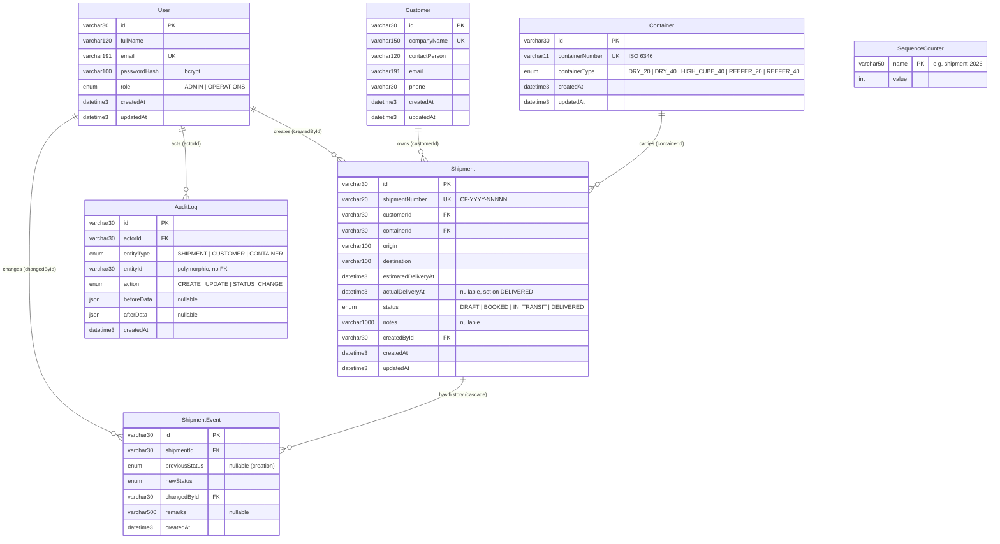

# CargoFlow — Entity Relationship Diagram

Generated from `apps/api/prisma/schema.prisma` (migration `20261125050748_init`). All timestamps
are `DATETIME(3)` in UTC. Ids are CUIDs (`VARCHAR(30)`).

## Relationships and delete behavior

| Relationship                                   | On delete                                    | Why                                                                     |
| ---------------------------------------------- | -------------------------------------------- | ----------------------------------------------------------------------- |
| Shipment → Customer, Container, User (creator) | `RESTRICT`                                   | History must not be orphaned. The API has no delete endpoints.          |
| ShipmentEvent → Shipment                       | `CASCADE`                                    | Events belong to the shipment. Only relevant for test-database resets.  |
| ShipmentEvent → User, AuditLog → User          | `RESTRICT`                                   | Actors of recorded history can't disappear.                             |
| AuditLog → entity                              | none (polymorphic `entityType` + `entityId`) | One audit table for all entity types. Labels are resolved at read time. |

## Constraints and indexes

| Table         | Unique            | Indexes                                                                                                                     |
| ------------- | ----------------- | --------------------------------------------------------------------------------------------------------------------------- |
| User          | `email`           |                                                                                                                             |
| Customer      | `companyName`     |                                                                                                                             |
| Container     | `containerNumber` |                                                                                                                             |
| Shipment      | `shipmentNumber`  | `(status, estimatedDeliveryAt)`, `(customerId, createdAt)`, `(containerId, status)`, `(createdAt)`, `(estimatedDeliveryAt)` |
| ShipmentEvent |                   | `(shipmentId, createdAt)`, `(createdAt)`                                                                                    |
| AuditLog      |                   | `(entityType, entityId, createdAt)`, `(actorId)`, `(createdAt)`                                                             |

Rules that a plain constraint can't express are enforced by the API inside transactions. For
example, "a container is on at most one undelivered shipment" is a conditional uniqueness rule
that MySQL can't declare. See [ARCHITECTURE.md](ARCHITECTURE.md#transaction-and-concurrency-strategy).

## Derived values (not stored)

| Value                 | Definition                                                                          |
| --------------------- | ----------------------------------------------------------------------------------- |
| Overdue               | `status ≠ DELIVERED AND estimatedDeliveryAt < now`                                  |
| Delivery performance  | `ON_TIME` if `actualDeliveryAt ≤ estimatedDeliveryAt`, else `LATE` (delivered only) |
| Active shipments      | `BOOKED + IN_TRANSIT`                                                               |
| On-time delivery rate | `round(onTimeDelivered / delivered × 100, 1)`, `null` when nothing is delivered     |
