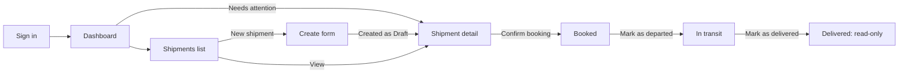

# CargoFlow — Product Requirements Document

## Overview

CargoFlow is an internal web application for a logistics operations team. It replaces
spreadsheets with one system for container shipments, from booking to delivery, with a live
dashboard and an audit trail. Business context and rules: [BRD.md](BRD.md).

## Personas

**Bima, operations coordinator (OPERATIONS).** Handles 20–40 active shipments. Needs to register
bookings fast, move shipments along as carriers confirm, and see each morning what is late or due.
Works mostly on a desktop, sometimes checks from a phone.

**Alya, operations manager (ADMIN).** Owns customer master data and answers to customers when
things go wrong. Needs reliable numbers (on-time rate) and to know who changed what.

## User stories

| ID    | As a…       | I want to…                                                          | So that…                           |
| ----- | ----------- | ------------------------------------------------------------------- | ---------------------------------- |
| US-1  | user        | sign in and be returned to the page I asked for                     | I can use deep links               |
| US-2  | coordinator | see overdue and due-soon shipments on one screen                    | I act before customers complain    |
| US-3  | coordinator | create a shipment by picking a customer and a free container        | I don't double-book equipment      |
| US-4  | coordinator | advance a shipment with a confirmation and optional remarks         | the history explains what happened |
| US-5  | coordinator | search by shipment number and filter by status, customer or overdue | I find shipments quickly           |
| US-6  | coordinator | revise an ETA after booking                                         | the schedule stays accurate        |
| US-7  | coordinator | see a shipment's timeline                                           | I can answer customer questions    |
| US-8  | manager     | add and edit customers                                              | master data stays correct          |
| US-9  | manager     | see an audit log with before/after values                           | I can trace any change             |
| US-10 | manager     | see the on-time delivery rate                                       | I can report performance           |
| US-11 | coordinator | register a new container                                            | new equipment can be used          |

## Functional requirements

| Area            | Requirement                                                                                                                                                                                                                                                               |
| --------------- | ------------------------------------------------------------------------------------------------------------------------------------------------------------------------------------------------------------------------------------------------------------------------- |
| Sign-in         | Email + password; field validation; clear errors for wrong credentials and rate limiting; protected routes redirect to sign-in with a return path; expired sessions return to sign-in with an explanation.                                                                |
| Navigation      | Dashboard, Shipments, Customers, Containers, Audit log (ADMIN only). Sidebar on desktop, menu on mobile.                                                                                                                                                                  |
| Dashboard       | Total, active, delivered, overdue, on-time rate (with "x of y"); pipeline by status (links to filtered list); needs-attention table (overdue / due within 48h); recent activity. All values from the API.                                                                 |
| Shipment list   | Search by number (debounced), status filter, schedule filter (overdue / not overdue), customer filter (from the customers page), sort (newest, oldest, ETA soonest, ETA latest), pagination. Filters live in the URL. Status badges, overdue badge, delivery performance. |
| Create shipment | Customer and container selects (only available containers), origin/destination with port suggestions, ETA in local time, notes. Client validation mirrors the API; server errors map to fields. Success opens the new shipment with a confirmation.                       |
| Shipment detail | Number, status, overdue alert, lifecycle rail, next-step action(s) with confirmation and remarks, route and schedule, customer and container, notes, status timeline, audit trail (ADMIN). Edit dialog shows only fields editable for this user and status.               |
| Customers       | Searchable, paginated list with shipment counts (linking to their shipments). ADMIN: add and edit in a dialog with validation.                                                                                                                                            |
| Containers      | Searchable list filtered by availability, showing the active shipment. Register with ISO 6346 validation.                                                                                                                                                                 |
| Audit log       | ADMIN only. Filter by record type and action; shows time, actor, record (linked for shipments), action and field-level changes.                                                                                                                                           |

## Workflows

## Non-functional requirements

| Area            | Requirement                                                                                                                                |
| --------------- | ------------------------------------------------------------------------------------------------------------------------------------------ |
| Security        | Server-side authorization on every endpoint; httpOnly session cookie; hashed passwords; login rate limiting; no secrets in the repository. |
| Integrity       | Lifecycle changes, history and audit committed atomically; concurrent conflicting changes rejected with a clear message.                   |
| Performance     | Dashboard computed by database aggregation; lists paginated (max 100 per page); indexed filters.                                           |
| Usability       | Loading, empty, error and success states on every view; field-level validation messages; confirmation before irreversible actions.         |
| Accessibility   | Keyboard navigation, visible focus, labelled controls, status never shown by colour alone, WCAG AA text contrast.                          |
| Responsiveness  | Desktop and tablet first-class; mobile usable without horizontal page scrolling.                                                           |
| Time            | Stored in UTC, shown in the viewer's time zone.                                                                                            |
| Maintainability | Typed end to end; business rules in one domain layer; automated unit, integration, component and E2E tests; CI.                            |

## MVP boundaries

Included: everything above. Deferred: user management UI, notifications, carrier integrations,
documents, reporting exports, quotation/pricing module, multi-tenant support, record deletion.
